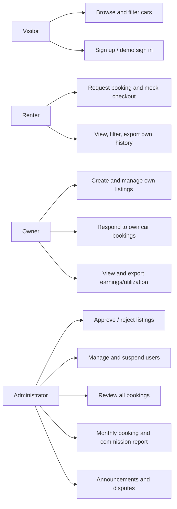
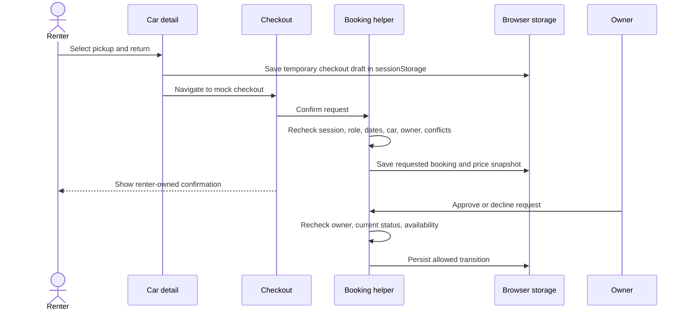

# Software Requirements Specification — Sheggar Wheels

## 1. Purpose and scope

Sheggar Wheels is a frontend capstone that demonstrates a peer-to-peer car rental marketplace for Addis Ababa. This implementation uses Next.js, React, JavaScript, and browser storage instead of a backend database. The main goals are a complete renter request journey, owner listing/request tools, and admin moderation/reporting. All accounts and transactions are fictional demo data.

## 2. Actors

| Actor | Capabilities |
| --- | --- |
| Visitor | Browse public pages; search/filter/sort cars; view details and map; sign up or sign in. |
| Renter | Request a booking, use mock checkout, view own booking/confirmation/history, filter/export own history, review eligible completed rentals, cancel eligible bookings, report a trip issue. |
| Owner | Create/edit own unapproved listings, view own listings and requests, approve/decline eligible requests, move rentals through lifecycle states, view earnings/utilization, export own data, reply to reviews. |
| Administrator | Approve/reject pending listings, view/manage/suspend/reinstate demo users, view all bookings, inspect monthly booking/commission metrics, export a platform report, publish announcements, resolve disputes. |

Owner and renter roles may coexist on one user record. Admin is seeded and is not a public-signup role.

## 3. Functional requirements

### Public catalogue

- Show only approved listings; expose car images, specs, neighbourhood, daily ETB price, and detail/map views.
- Search cars and filter by city/neighbourhood, price, transmission, seat count, and pickup/return dates.
- Sort by price, newest, or booking-count popularity; paginate with a visible page indicator.
- Persist filter/sort/page state in shareable URL query parameters.

### Session and renter booking

- Authenticate only seeded/demo accounts; store only the signed-in user ID in sessionStorage.
- Validate safe internal return paths and reject external destinations.
- Validate future pickup, return-after-pickup, active account/renter role, approved car, active owner, unavailable dates, and overlapping active bookings.
- Snapshot daily price, duration, subtotal, fee, total, and status into the booking record.
- Mock TeleBirr checkout must never collect real payment credentials or claim a real charge. It stores a clearly fake demo reference, shows a confirmation, and keeps owner approval as a separate booking state.
- Renter history and booking detail must be restricted to the current renter. History supports search/status/car/date filters and CSV export.

### Owner workflows

- Create listings as pending. Owners may edit only listings they own while they are not approved; approved listing edits are locked.
- Only approved listings are publicly visible. Admin must approve before publication; rejection saves a reason.
- Owner booking lists show only bookings for cars that owner owns. Owner approval rechecks booking state and date conflicts.
- Owner dashboard reports completed rental value and utilization; export includes own booking/earnings data.

### Admin workflows and reports

- Admin can approve or reject only listings still pending review. Reject requires a reason.
- Admin can view demo accounts and suspend/reinstate users. Suspension blocks session actions and hides that owner's listings; reinstatement restores their prior listing status. Do not suspend the current admin or last active admin.
- Admin can view all bookings, filter/search them, inspect status and price snapshots, and export platform records.
- Admin reports monthly booking count and recorded mock commission; commission is the sum of booking fee snapshots. The current fee is zero, so the report is zero unless the fee rule is changed.
- Admin can publish announcements and resolve disputes with a note.

## 4. Non-functional requirements

- Responsive layouts for mobile and desktop; semantic labels, focus visibility, keyboard operability, meaningful loading/empty/error/success states.
- Storage parsing/writes must be guarded and fail without crashing the full application.
- No real password, payment credential, API secret, or personal customer data is stored.
- Browser-based role/ownership checks are demonstration safeguards only, not security guarantees.
- Use Recharts for owner/admin reporting and Leaflet in the browser for the car map.
- Keep documentation truthful about client storage, mock checkout/commission, map tiles, deployment, and measurement status.

## 5. Business rules and booking lifecycle

Rental duration is the day difference: return date is later than pickup, and the interval is `[pickup, return)`. `requested`, `confirmed`, and `in_progress` records block overlapping requests on the same car. Owner approval repeats availability/conflict validation. The implemented state transitions include requested → confirmed/declined/cancelled; confirmed → in_progress/cancelled; in_progress → completed/disputed; completed → reviewed; disputed → resolved.

## 6. High-level use case diagram



## 7. Data relationship diagram

```mermaid
erDiagram
  USER ||--o{ CAR : owns
  USER ||--o{ BOOKING : rents
  CAR ||--o{ BOOKING : requested_for
  BOOKING ||--o| REVIEW : receives
  USER ||--o{ REVIEW : writes_or_replies
  BOOKING ||--o{ DISPUTE : may_have
  USER ||--o{ DISPUTE : opens_or_resolves
  USER ||--o{ ANNOUNCEMENT : publishes
  USER { string id PK; string name; string email; string status; string[] roles }
  CAR { string id PK; string ownerId FK; string status; number pricePerDay; string neighbourhood }
  BOOKING { string id PK; string carId FK; string renterId FK; string ownerId FK; string startDate; string endDate; number fee; number total; string status }
  REVIEW { string id PK; string bookingId FK; number rating; string comment; string ownerReply }
  DISPUTE { string id PK; string bookingId FK; string openedBy FK; string status; string resolution }
  ANNOUNCEMENT { string id PK; string createdBy FK; string title; boolean active }
```

## 8. Booking request flow



## 9. Constraints, assumptions, and out of scope

- No backend/database, production authentication, real payment integration, real-time updates, or GPS service is implemented.
- Storage is per-browser and editable by the user.
- Commission is not configured as a percentage; reports use `booking.fee` snapshots, currently zero.
- Suggested brief routes are consolidated: admin sections are under `/admin`, and owner earnings is under `/owner` rather than separate `/admin/*` or `/owner/earnings` pages.
- Deployment URL, portfolio screenshots, and Lighthouse scores must be added after those activities occur.
